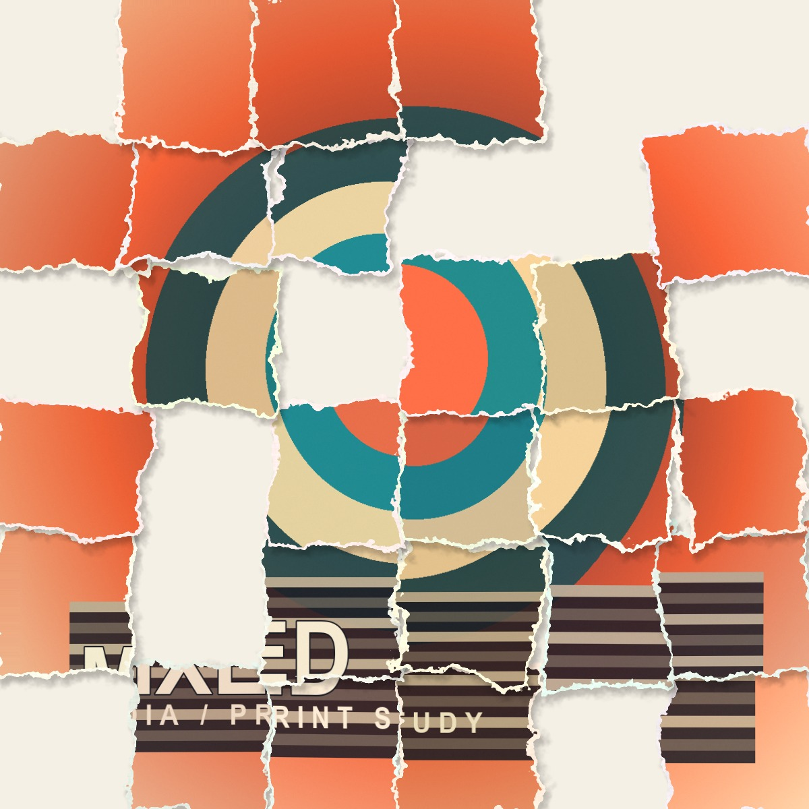
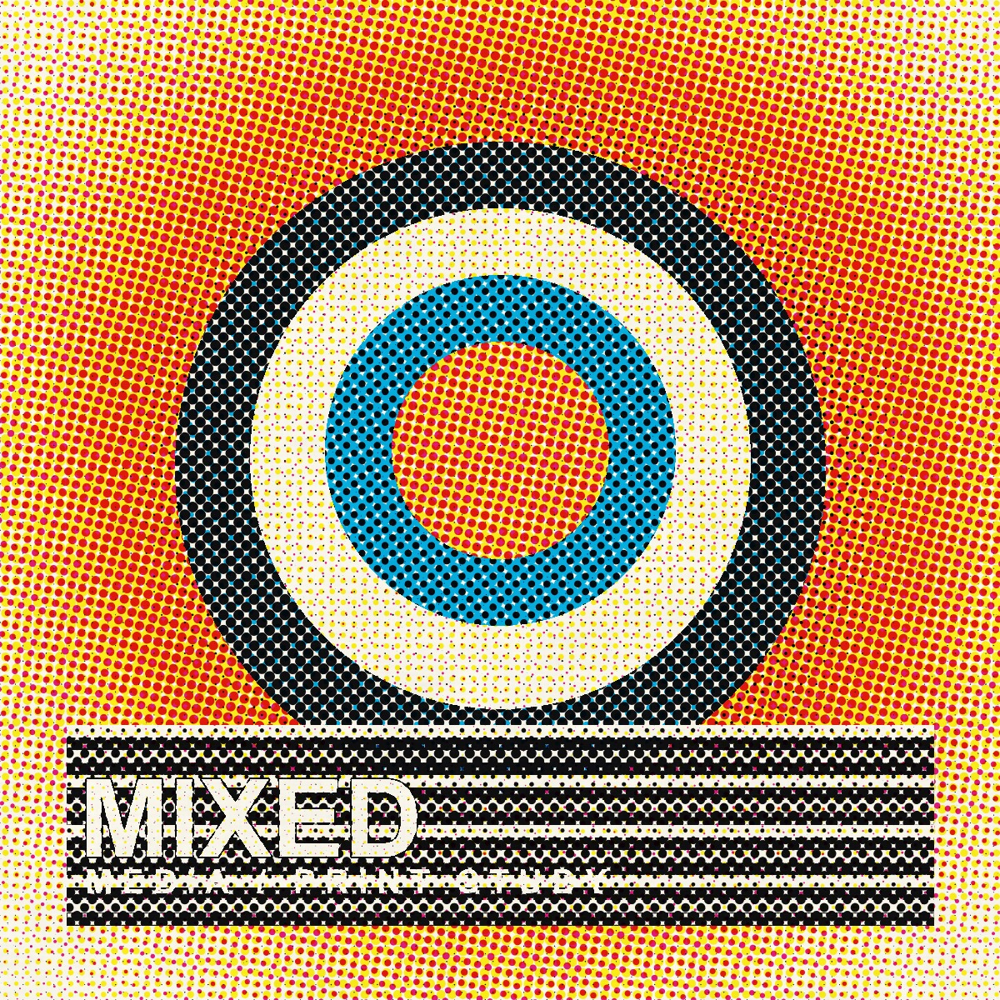
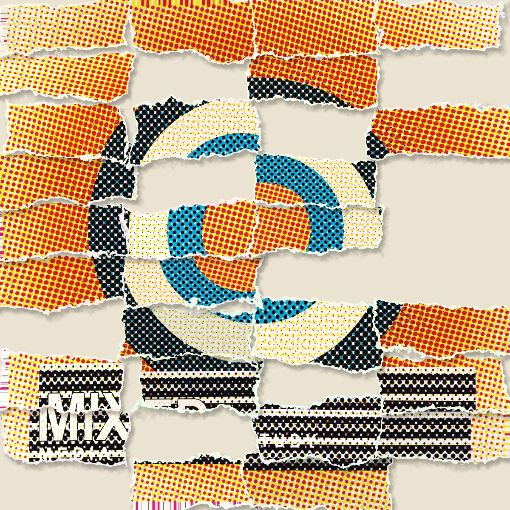
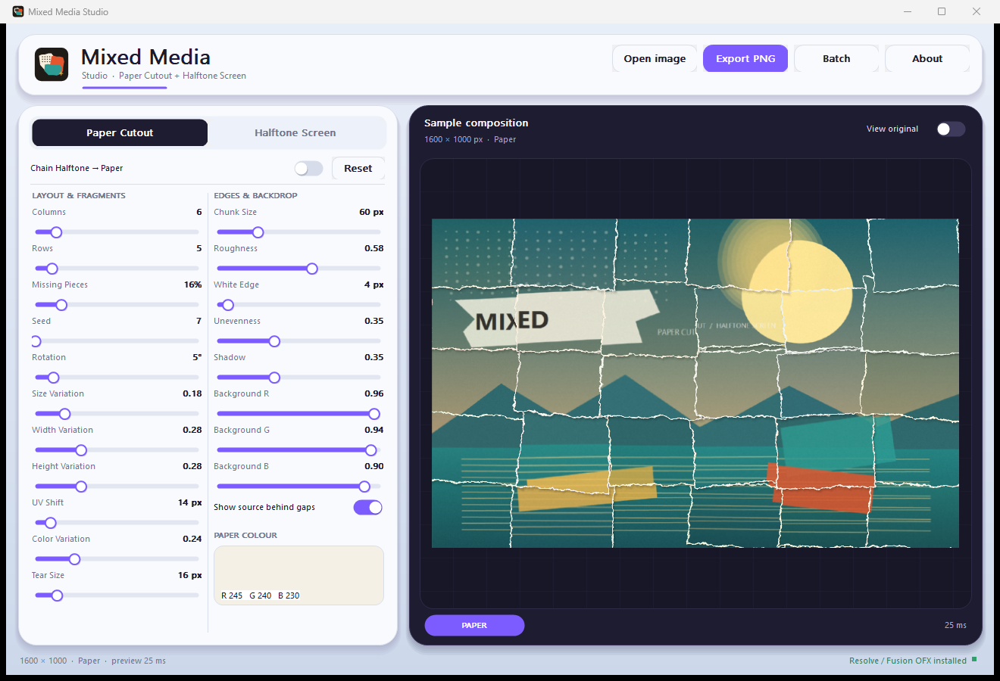
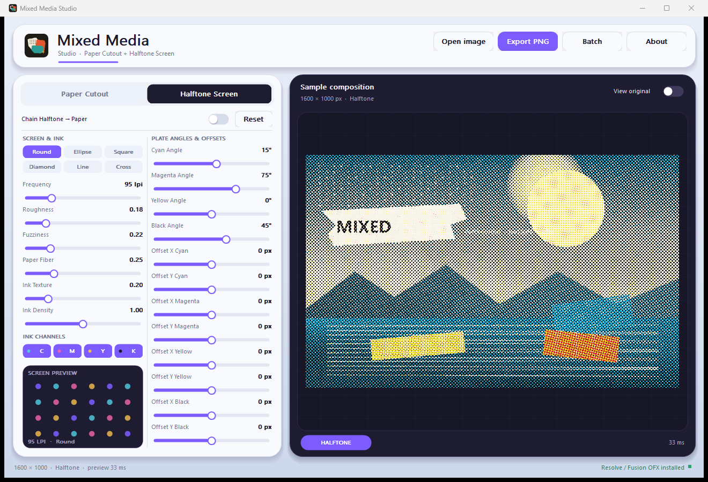
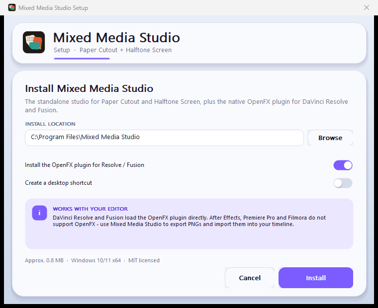

# Mixed Media OFX + Studio

Two native OpenFX image effects for DaVinci Resolve, built around the workflow
of effect.app's **Mixed Media** look:

- **Paper Cutout** – a grid of layered, torn paper scraps with per-scrap
  transforms, colour variation, missing pieces, white paper cores and shadows.
- **Halftone Screen** – a CMYK AM halftone with per-channel screen angles and
  registration offsets, dot shapes, ink density, paper fibre and ink texture.

They are independent filters, so they can be used alone or chained (Halftone
Screen first, then Paper Cutout) in the Color page node graph or Edit page
OpenFX stack. Every numeric and boolean control is keyframeable. In particular,
**Seed** and **Missing Pieces (%)** can be animated to move the collage over
time, matching the animated behaviour of the Mixed Media preset.

The plugin is CUDA-first on Windows. Resolve hands it device pointers and the
kernels write straight into the output image with no host round-trip. A
multithreaded CPU renderer is included as a fallback.

The repository also builds **Mixed Media Studio**, a standalone Windows app that
uses the same CPU renderer. It is for editors that do not load OpenFX - After
Effects, Premiere Pro and Filmora - and exports full-resolution PNG stills or a
batch-processed PNG sequence. The companion `MixedMediaSetup.exe` installs the
Studio app and, optionally, the OpenFX plugin for Resolve/Fusion.







---

## Features

### Paper Cutout

| Control | Default | Range | Notes |
|---|---:|---:|---|
| Columns | 6 | 1–40 | Grid is laid out in output pixel space. |
| Rows | 5 | 1–40 | |
| Missing Pieces (%) | 16 | 0–100 | Percentage of scraps removed. Keyframe it. |
| Seed | 7 | 0–99999 | Layout seed. Keyframe it to move every scrap and gap. |
| Rotation | 5° | 0–45° | Maximum random rotation per scrap. |
| Size Variation | 0.18 | 0–1 | Overall scale variation. |
| Width Variation | 0.28 | 0–1 | Independent width variation. |
| Height Variation | 0.28 | 0–1 | Independent height variation. |
| UV Shift (px) | 14 | 0–150 | Random source-image shift inside each scrap. |
| Color Variation | 0.24 | 0–1 | Per-scrap tint and exposure variation. |
| Tear Size (px) | 16 | 0–120 | Size of the ragged edge features. |
| Chunk Size (px) | 60 | 0–240 | Large bites and deep pieces missing from the edge. |
| Roughness | 0.58 | 0–1 | Amount of high-frequency tearing. |
| White Edge (px) | 4 | 0–60 | Exposed white paper core around the image. |
| Unevenness | 0.35 | 0–1 | Scrap offsets, edge irregularity and layer misalignment. |
| Shadow | 0.35 | 0–1 | Soft drop shadow and offset. |
| Background Image | On | On/Off | Show the source behind missing scraps, or use a flat colour. |
| Background Color | Warm paper | RGB | Used when Background Image is off. |

Pixel-based controls are authored against a 1080p short side and scale with the
rendered image, so the same settings look consistent at HD, 4K and proxy sizes.

### Halftone Screen

| Control | Default | Range | Notes |
|---|---:|---:|---|
| Pattern | Round | 6 shapes | Round, Ellipse, Square, Diamond, Line, Cross. |
| Frequency | 95 | 4–400 | Lines per 1000 px of the 1080p reference. Higher = finer. |
| Roughness | 0.18 | 0–1 | Screen distortion and ragged dot edges. |
| Fuzziness | 0.22 | 0–1 | Ink-edge softness / absorption. |
| Paper Fiber | 0.25 | 0–1 | Directional paper tooth and low-frequency mottle. |
| Ink Texture | 0.20 | 0–1 | Ink density variation and press grain. |
| Ink Density | 1.0 | 0–2 | Dot gain / ink load. |
| Cyan / Magenta / Yellow / Black | On | On/Off | Individual ink channels. |
| Cyan Angle | 15° | −180–180° | Standard process angle. |
| Magenta Angle | 75° | −180–180° | |
| Yellow Angle | 0° | −180–180° | |
| Black Angle | 45° | −180–180° | |
| Offset X / Y per channel | 0 | −200–200 px | Individual plate registration offsets. |

If every ink channel is off you get a bare paper field. The halftone stays
locked to image coordinates, so it does not crawl or flicker unless you animate
its controls.

---

## Requirements

- Windows x64.
- A 1080p or larger display is recommended for the standalone Studio UI.
- DaVinci Resolve 18, 19 or 20 (tested with Resolve 20.3.2) for the OFX path.
- Visual Studio Build Tools with the **Desktop development with C++** workload.
- Python 3 (for the PTX build step).
- An NVIDIA GPU with a current driver for the CUDA path. Without CUDA, the
  plugin still renders through the CPU fallback.

No CUDA Toolkit is required. The build uses the `nvrtc64_*.dll` installed with
DaVinci Resolve to compile `cuda/MixedMediaKernels.cu` to PTX. The PTX is
embedded in the `.ofx`; at runtime the plugin loads only `nvcuda.dll`.

---

## Build

Close Resolve first. From the project folder:

```powershell
powershell -ExecutionPolicy Bypass -File .\build.ps1
```

This produces:

```text
dist\MixedMedia.ofx.bundle\Contents\Win64\MixedMedia.ofx
dist\MixedMedia-ofx-windows-x64.zip
```

By default the build also compiles and runs the OFX host test and the CPU/CUDA
parity test. Use `-SkipTests` for a faster build:

```powershell
.\build.ps1 -SkipTests
```

### Build pieces

1. `tools/compile_ptx.py` compiles the CUDA kernel to PTX with NVRTC.
2. `cl.exe` builds the plugin with `/MT` (the C++ runtime is statically linked).
3. The tests build `ofx_host_test.exe`, `gpu_parity.exe` and `render_cli.exe`.

The NVRTC DLL is located from Resolve's installation folder. To use a
different one:

```powershell
python tools\compile_ptx.py --nvrtc "C:\Path\nvrtc64_120_0.dll"
```

The PTX virtual architecture defaults to `compute_75` and JITs on newer NVIDIA
GPUs. For a different minimum target:

```powershell
python tools\compile_ptx.py --arch compute_86
```

---

## Install

Close Resolve, then in an elevated PowerShell:

```powershell
powershell -ExecutionPolicy Bypass -File .\install.ps1
```

The bundle is copied to:

```text
C:\Program Files\Common Files\OFX\Plugins\MixedMedia.ofx.bundle
```

The installer removes `%APPDATA%\Blackmagic Design\DaVinci Resolve\Support\OFXPluginCacheV2.xml`
so Resolve rescans on the next launch. Uninstall with:

```powershell
.\install.ps1 -Uninstall
```

For a portable install without copying, point Resolve at the `dist` folder:

```powershell
$env:OFX_PLUGIN_PATH = (Resolve-Path .\dist).Path
& "C:\Program Files\Blackmagic Design\DaVinci Resolve\Resolve.exe"
```

In Resolve, find both effects under:

```text
Effects > OpenFX > Mixed Media > Paper Cutout
Effects > OpenFX > Mixed Media > Halftone Screen
```

They are also available in the Fusion page's OpenFX category and in the Color
page Open FX panel.

---

## Windows installer and standalone Studio

OpenFX is only loaded by OpenFX hosts. After Effects, Premiere Pro and Filmora
use their own plugin formats and cannot load `.ofx` bundles. The cross-editor
path is **Mixed Media Studio**, which renders the same two effects on the CPU and
exports PNGs.





Build the Studio app and the single-file installer:

```powershell
.\build-studio.ps1
.\build-setup.ps1
```

Or run everything in one go:

```powershell
.\build-all.ps1
```

Outputs:

```text
dist\MixedMediaStudio.exe          portable standalone app
dist\MixedMediaSetup.exe           installer with the Studio app + OFX plugin
dist\MixedMedia-ofx-windows-x64.zip
```

`MixedMediaSetup.exe` installs to `C:\Program Files\Mixed Media Studio`, creates
Start Menu shortcuts and an uninstaller, and optionally copies the OpenFX bundle
to `C:\Program Files\Common Files\OFX\Plugins`. It also clears Resolve's OFX
cache.



Silent installation is available for deployment:

```powershell
.\MixedMediaSetup.exe /S /NOLAUNCH
.\MixedMediaSetup.exe /S /D="D:\Apps\Mixed Media Studio" /NOOFX /NODESKTOP
.\MixedMediaSetup.exe /uninstall /silent
```

### Using Studio with After Effects, Premiere Pro or Filmora

1. Open a still, or export a PNG sequence from the editor.
2. Use **Export PNG** for one frame, or **Batch** to apply the current look to a
   folder of PNG/JPEG/BMP/TIFF images (`name_mixedmedia.png`).
3. Import the rendered PNGs back into the timeline. The Studio app, the OFX
   plugin and the CUDA kernels share the same Paper Cutout and Halftone Screen
   maths, so the look matches Resolve.

Studio settings are stored in `%APPDATA%\MixedMediaStudio\settings.ini`. The
Studio app needs no Resolve installation and no NVIDIA GPU; the OFX plugin uses
CUDA when Resolve is set to CUDA GPU processing and falls back to the CPU
renderer otherwise.

The executables are unsigned. Windows SmartScreen may ask for confirmation the
first time they are run; choose **More info > Run anyway** if you trust the
build.

---

## Using the effects together

For the Mixed Media look:

1. Add **Halftone Screen** to a clip or Color page node.
2. Add **Paper Cutout** after it.
3. Start with Paper Cutout's **Background Image** off and a flat paper colour to
   make missing scraps readable, or leave it on to keep the photograph behind
   the gaps.
4. To animate the collage, enable keyframes on **Seed** and **Missing Pieces
   (%)**. Because the layout is generated from the values at each render time,
   changing Seed rearranges every scrap and gap. For a stop-motion rhythm, use
   stepped keyframes or pair it with Resolve's retiming tools.

The OFX controls use Resolve's normal keyframe UI; no separate animation panel
is required.

---

## GPU behaviour

- Descriptor advertises `OfxImageEffectPropCudaRenderSupported = true` and
  `OfxImageEffectPropCudaStreamSupported = true`.
- On render, the plugin checks `OfxImageEffectPropCudaEnabled` and uses the
  supplied `OfxImageEffectPropCudaStream`.
- Source and destination are Resolve CUDA device buffers. A tiny setup kernel
  generates the per-scrap transforms; the main kernel writes directly into the
  output. No frame is copied to system memory.
- The CUDA module and kernel functions are cached per CUDA context, shared by
  all instances. A per-instance 1600-scrap buffer is reused.
- `OfxImageEffectPropCPURenderSupported` is also true, so if Resolve does not
  hand the effect CUDA images the render still succeeds on the CPU.
- **Resolve must use CUDA GPU processing for the GPU path.** Set
  *Preferences > System > Memory and GPU > GPU processing mode* to **CUDA**. In
  OpenCL mode Resolve will use the plugin's CPU fallback; an OpenCL backend is
  not included in this version.

Render path and errors are logged to:

```text
%LOCALAPPDATA%\MixedMediaOFX\mixedmedia.log
```

A CUDA render logs:

```text
CUDA ready on NVIDIA GeForce GTX 1650 (device 0)
rendering on CUDA path (NVIDIA GeForce GTX 1650)
Paper Cutout: CUDA render 1920x1080
```

On the development GTX 1650, the direct 1080p CUDA kernels measured about
**6.5 ms** for Paper Cutout and **5.6 ms** for Halftone Screen (warm, full frame,
including the device-to-host readback used by the harness). Exact timeline
performance depends on the GPU, resolution and Resolve's scheduling.

### Colour and alpha

The effects operate in the host's working colour space and do not force a
conversion. Premultiplied input is un-premultiplied for sampling and the output
is premultiplied when the input is. Source alpha is preserved. Video clips are
normally opaque.

---

## Tests

`build.ps1` runs:

- `ofx_host_test.exe` - loads the real `.ofx` DLL, calls Describe and
  DescribeInContext for both plugins, creates instances, checks all parameter
  definitions (including `Animates = 1`), checks Seed and Missing Pieces
  keyframes, verifies the halftone channel/angle/offset controls, and exercises
  the **real CUDA OFX branch** with device pixel buffers
  (`kOfxImageEffectPropCudaEnabled = 1`).
- `gpu_parity.exe` - creates a real CUDA context, uploads a source frame, runs
  the same CUDA entry points Resolve uses, and compares the result to the CPU
  reference. Current maximum channel difference is below `1e-3` (float rounding
  plus `sinf`/`cosf` differences).

The CUDA host-path test uses a real CUDA stream, so it also covers the
`OfxImageEffectPropCudaStream` launch path. It reports maximum CPU/CUDA
differences of about `5e-5` for Paper Cutout and `1e-4` for Halftone Screen at
128x128.

DaVinci Resolve 20.3.2 was used to scan the installed bundle. Both plugins
registered with `status="0"` in `OFXPluginCacheV2.xml`. The CPU host test and the
direct CUDA backend test cover the render paths; Resolve's GPU image hand-off is
the same `OfxImagePropData` / `OfxImageEffectPropCudaEnabled` path validated by
the backend test.

To inspect images, use the development renderer:

```powershell
# Prepare a bottom-up float RGBA raw image with tests/data not included in git,
# then render. See tests/render_cli.cpp for the parameter list.
.\build\render_cli.exe --effect paper --width 900 --height 900 `
  --in frame.rgba --out paper.bmp --columns 6 --rows 5 --seed 7

.\build\render_cli.exe --effect halftone --width 900 --height 900 `
  --in frame.rgba --out halftone.bmp --frequency 95 --pattern 0
```

The renderer writes 24-bit BMP. Render a halftone result, convert it back to
raw RGBA, and feed it to Paper Cutout to preview the combined stack.

---

## Project layout

```text
src/
  Plugin.cpp          OFX registration, parameters, render dispatch
  EffectMath.h        shared CPU/CUDA paper and halftone pixel math
  CpuRender.cpp/.h    multithreaded CPU fallback
  CudaBackend.cpp/.h  nvcuda driver loader, module cache, kernel launches
  Log.cpp/.h          optional local log
cuda/
  MixedMediaKernels.cu  setup + paper + halftone entry points
studio/
  Studio.cpp          standalone Win32 studio UI, preview, export and batch
  ImageIO.cpp/.h      WIC image loading and PNG export
  Studio.rc           icon, manifest, accelerators, version info
installer/
  Setup.cpp           self-contained installer, shortcuts and uninstaller
  Setup.rc            embedded Studio app + OFX plugin + docs
tools/
  compile_ptx.py      NVRTC -> PTX -> generated/MixedMediaPTX.h
  make_icon.ps1       generates the app icon
tests/
  ofx_host_test.cpp   minimal OFX host
  gpu_parity.cpp      CPU/CUDA parity and timing
  render_cli.cpp      development BMP renderer
docs/                 rendered previews used by this README
vendor/openfx/        OpenFX headers (BSD-3-Clause)
```

---

## Limitations

- Windows x64 and CUDA only for GPU acceleration. The CPU fallback works
  without an NVIDIA GPU, but it is not a real-time path.
- OpenFX works in DaVinci Resolve and Fusion, not in After Effects, Premiere
  Pro or Filmora. Those editors use the standalone Studio app and imported
  PNGs instead. Native `.aex` / Premiere plugin ports would require the Adobe
  SDKs and are not part of this build.
- The plugin accepts float RGBA images, matching Resolve's GPU OFX pipeline.
  It does not process 8-bit or half-float buffers directly.
- Full-frame filters: tiling is disabled, and the region of definition equals
  the source. Scraps and shadows are clipped at the frame boundary.
- The `frequency` and pixel-size controls are scaled relative to the short side
  of the rendered image, not a physical print LPI measurement.
- The build depends on Resolve's NVRTC DLL unless a CUDA Toolkit is installed.

---

## Licence and attribution

Plugin source is MIT licensed; see `LICENSE`.

OpenFX headers are BSD-3-Clause; see `vendor/openfx/LICENSE.md`.

This is an independent implementation inspired by the public effect.app
Mixed Media, Paper Cutout and Halftone Screen controls. It does not contain
Effect.app code, shaders, media or presets and is not affiliated with Effect.app
or Blackmagic Design.
